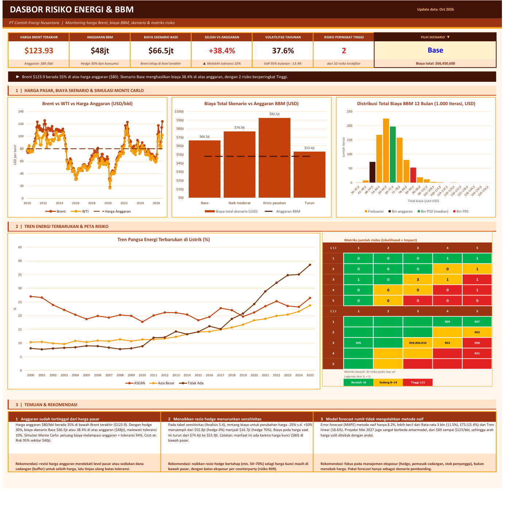

# Fuel Price Risk Model in Excel

An Excel model of fuel price risk for a fictional company whose fuel cost follows Brent crude. It covers VaR / ES, a 1,000-iteration Monte Carlo, scenarios with hedge sensitivity, forecast comparison, and an ISO 31000 risk register, all summarised in an interactive dashboard.

| File | Contents |
|---|---|
| [`fuel_price_risk_model.xlsx`](fuel_price_risk_model.xlsx) | The model: data, formulas, simulation, risk register, and dashboard. Open it in Excel 365 (it uses `XLOOKUP` and `FORECAST.ETS`) |
| [`fuel_price_risk_dashboard.pdf`](fuel_price_risk_dashboard.pdf) | One-page export of the dashboard |

## Business question

*PT Contoh Energi Nusantara* (fictional) buys 600,000 barrels of fuel a year. Its budget assumes $80/bbl, and 30% of the volume is hedged at that price. The model answers three questions:
1. How far can next year's fuel cost overshoot the budget?
2. How much does a higher hedge ratio help?
3. Can the Brent price be forecast well enough to plan on it?

## Data and licenses

| Data | Source | License |
|---|---|---|
| Monthly Brent and WTI prices, Jan 2010 – Oct 2026 (USD/bbl) | EIA via [datasets/oil-prices](https://github.com/datasets/oil-prices) | Public Domain (ODC-PDDL) |
| Energy data for 10 countries, 2000–2025 (renewable and coal share of electricity) | [Our World in Data energy-data](https://github.com/owid/energy-data), based on Energy Institute, EIA, Ember | CC BY 4.0 |
| Company parameters, scenarios, exchange rate, and Likelihood / Impact scores | Practice assumptions | Fictional |

## Method

| Sheet | What it does | Excel tools |
|---|---|---|
| `Parameter` | Inputs: consumption, budget price, hedge ratio, VaR confidence, tolerance, scenario table | Named ranges, blue input cells |
| `Data_Harga` | Monthly log returns of Brent and WTI, and the Brent–WTI spread | `LN`, `YEAR` |
| `Analisis` | **Risk metrics:** volatility, historical and parametric VaR 95%, Expected Shortfall, Brent–WTI correlation, VaR / ES in USD | `PERCENTILE.INC`, `NORM.INV`, `AVERAGEIF`, `CORREL` |
| | **Scenarios:** Base, +20%, +50%, −25%, with cost vs budget and a dropdown to pick one | `XLOOKUP`, data validation |
| | **Sensitivity:** cost by hedge ratio (0–70%) × price change | Two-way table |
| | **Forecast comparison:** naive, 3-month average, linear trend, and ETS, scored by MAPE / MAE | `FORECAST.LINEAR`, `FORECAST.ETS`, Forecast Sheet |
| | **Renewables:** share of electricity by country group | Pivot table, slicer, `XLOOKUP` with a not-found case |
| `Simulasi Monte Carlo` | 1,000 price paths of 12 months. Each month the price is multiplied by `exp(σ·Z)`, with σ = the monthly volatility of the last 60 months and no drift. The output is the cost distribution, P5 / P50 / P95, the chance of exceeding budget + tolerance, Cost-at-Risk, and a histogram | `RAND`, `NORM.S.INV`, `COUNTIFS` |
| `Risk_Register` | 10 risks scored Likelihood × Impact and rated Low (< 8), Medium (8–14) or High (≥ 15), plus a 5 × 5 heat map, following the ISO 31000 assess–treat cycle | `COUNTIFS`, conditional formatting |
| `Dasbord` | KPI cards, scenario selector, 4 charts, risk matrix, and three findings with recommendations whose text updates from the formulas | Linked text formulas |

## Findings

| Metric | Value |
|---|---|
| Latest Brent (Oct 2026) | $123.9/bbl, 55% above the $80 budget price |
| Annualised volatility | 37.6% |
| Monthly VaR 95% (historical) / Expected Shortfall | −13.4% / −26.5% of the price |
| Base scenario cost | $66.5M vs $48M budget (+38.4%, above the 10% tolerance) |
| Monte Carlo: P50 / P95 cost | ≈ $67M / ≈ $89M |
| Chance of exceeding budget + tolerance | ≈ 94–95% |
| Cost-at-Risk 95% (P95 − budget) | ≈ $40–41M |
| High-rated risks | 2 of 10 (Brent price spike R01, SCADA cyber attack R08) |

1. **The budget is behind the market.** Even in the Base scenario the cost is 38% over budget. **Recommendation:** move the budget price toward the market level or set aside a buffer, and review the tolerance.
2. **A higher hedge ratio narrows the range.** Across −25% to +50% price moves, the cost range shrinks from $55.8M at 0% hedge to $16.7M at 70% hedge. **Recommendation:** raise the hedge in steps (50–70%) while the locked price is below the market, with an exposure limit per counterparty (risk R09).
3. **Simple beats complex in forecasting.** The naive forecast has the lowest MAPE (8.2%), ahead of the 3-month average (11.5%), ETS (15.4%), and linear trend (18.6%). Forecasts for May 2027 range from $69 to $123/bbl. **Recommendation:** manage exposure (hedging, backup suppliers, buffer stock) rather than bet on a price forecast.

## Limitations

- **Fictional company.** Consumption, budget, hedge, exchange rate, scenarios, and risk scores are practice assumptions, not real figures.
- **Zero drift.** The simulation assumes no price trend; only volatility moves the price.
- **Lognormal returns.** Monthly shocks are normal in log terms, which understates fat tails and price jumps.
- **Hedge locked at the budget price.** The hedged volume is priced at $80/bbl. A real hedge would be struck at the forward price, so the hedge benefit shown is optimistic while the market is above budget.
- **Not reproducible to the dollar.** The simulation uses `RAND()`, so Monte Carlo results shift slightly on every recalculation, which is why the table above shows ranges.
- **Monthly data only.** Average monthly prices hide intra-month volatility.

## License

The workbook and documentation are under [MIT](LICENSE) © 2026 Naufaldo Indra Pratama. The data keeps its original licenses (ODC-PDDL for EIA prices, CC BY 4.0 for Our World in Data).
